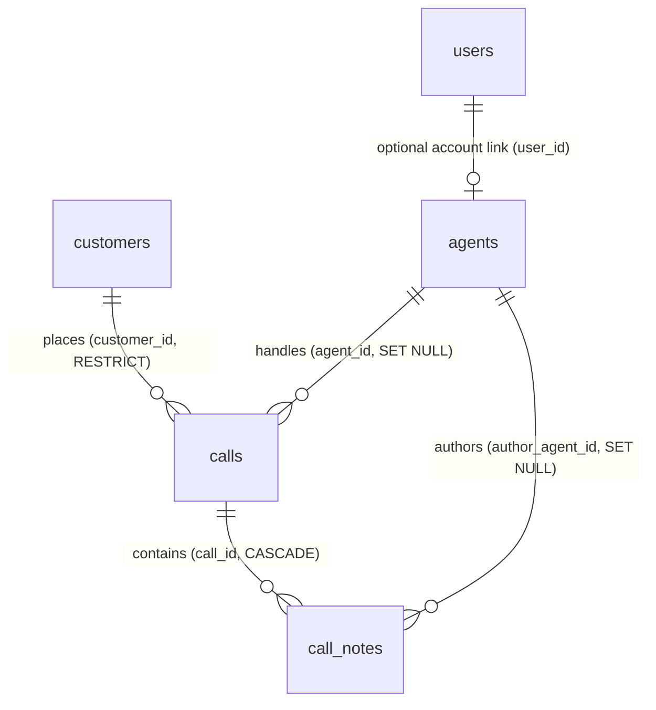

# CallFlow Database & Entity Layer

CallFlow uses **PostgreSQL** (`18.4` verified locally) with **Flyway** schema migrations (`classpath:db/migration` and dev-only `classpath:db/seed`) and **Spring Data JPA / Hibernate** (`spring.jpa.hibernate.ddl-auto: validate`).

## Entity-Relationship Overview

## Flyway Migrations

| Version | Location | Description | Scope |
| --- | --- | --- | --- |
| `V1` | `backend/src/main/resources/db/migration/V1__init_schema.sql` | Initial tables, foreign keys, check constraints, and core indexes | All profiles |
| `V2` | `backend/src/main/resources/db/seed/V2__dev_seed_data.sql` | Sample customers, agents, calls, and call notes | `dev` profile only |
| `V3` | `backend/src/main/resources/db/migration/V3__add_supporting_indexes.sql` | Functional lowercase email indexes (`users`, `agents`) and `call_notes(author_agent_id)` index | All profiles |

> **Note:** In `dev` profile, `DevDataSeeder` seeds `admin@callflow.local` (`ADMIN`) and `agent@callflow.local` (`AGENT`) into `users` at startup when `CALLFLOW_DEV_SEED_USERS=true` and passwords are provided via environment variables.

## Tables & JPA Entity Mappings

All timestamped entities (`User`, `Customer`, `Agent`, `Call`) extend `BaseTimestampedEntity`, which maps `created_at` (`updatable = false`) and `updated_at` (`TIMESTAMPTZ`) via `@PrePersist` / `@PreUpdate`. `CallNote` manages an immutable `created_at` column via `@PrePersist`.

### 1. `users` (`com.callflow.entity.User`)
| Column | Type | Constraints / Default | Notes |
| --- | --- | --- | --- |
| `id` | `BIGSERIAL` | `PRIMARY KEY` | `GenerationType.IDENTITY` |
| `email` | `VARCHAR(255)` | `NOT NULL`, `UNIQUE (uq_users_email)` | Lowercased by seeder/service |
| `full_name` | `VARCHAR(150)` | `NOT NULL` | Display name |
| `password_hash` | `VARCHAR(255)` | `NOT NULL` | BCrypt hash |
| `role` | `VARCHAR(20)` | `NOT NULL`, `CHECK (role IN ('ADMIN', 'AGENT'))` | Maps to `UserRole` |
| `enabled` | `BOOLEAN` | `NOT NULL DEFAULT TRUE` | Account status |
| `created_at` | `TIMESTAMPTZ` | `NOT NULL DEFAULT NOW()` | Inherited timestamp |
| `updated_at` | `TIMESTAMPTZ` | `NOT NULL DEFAULT NOW()` | Inherited timestamp |

- **Indexes**: `users_pkey`, `uq_users_email`, `idx_users_email_lower` (`LOWER(email)`)

### 2. `customers` (`com.callflow.entity.Customer`)
| Column | Type | Constraints / Default | Notes |
| --- | --- | --- | --- |
| `id` | `BIGSERIAL` | `PRIMARY KEY` | `GenerationType.IDENTITY` |
| `first_name` | `VARCHAR(100)` | `NOT NULL` | Trimmed by mapper |
| `last_name` | `VARCHAR(100)` | `NOT NULL` | Trimmed by mapper |
| `email` | `VARCHAR(255)` | `NOT NULL`, `UNIQUE (uq_customers_email)` | Normalized lowercase |
| `phone_number` | `VARCHAR(30)` | `NOT NULL`, `UNIQUE (uq_customers_phone)` | Unique contact number |
| `created_at` | `TIMESTAMPTZ` | `NOT NULL DEFAULT NOW()` | Inherited timestamp |
| `updated_at` | `TIMESTAMPTZ` | `NOT NULL DEFAULT NOW()` | Inherited timestamp |

- **Indexes**: `customers_pkey`, `uq_customers_email`, `uq_customers_phone`, `idx_customers_email_lower` (`LOWER(email)`), `idx_customers_name` (`LOWER(last_name), LOWER(first_name)`)

### 3. `agents` (`com.callflow.entity.Agent`)
| Column | Type | Constraints / Default | Notes |
| --- | --- | --- | --- |
| `id` | `BIGSERIAL` | `PRIMARY KEY` | `GenerationType.IDENTITY` |
| `user_id` | `BIGINT` | `UNIQUE (uq_agents_user_id)`, `FK -> users(id) ON DELETE SET NULL` | Optional `@OneToOne` link |
| `first_name` | `VARCHAR(100)` | `NOT NULL` | Trimmed by mapper |
| `last_name` | `VARCHAR(100)` | `NOT NULL` | Trimmed by mapper |
| `email` | `VARCHAR(255)` | `NOT NULL`, `UNIQUE (uq_agents_email)` | Normalized lowercase |
| `availability_status` | `VARCHAR(20)` | `NOT NULL DEFAULT 'AVAILABLE'`, `CHECK (availability_status IN ('AVAILABLE', 'BUSY', 'AWAY', 'OFFLINE'))` | Maps to `AgentAvailabilityStatus` |
| `created_at` | `TIMESTAMPTZ` | `NOT NULL DEFAULT NOW()` | Inherited timestamp |
| `updated_at` | `TIMESTAMPTZ` | `NOT NULL DEFAULT NOW()` | Inherited timestamp |

- **Indexes**: `agents_pkey`, `uq_agents_user_id`, `uq_agents_email`, `idx_agents_availability`, `idx_agents_name` (`LOWER(last_name), LOWER(first_name)`), `idx_agents_email_lower` (`LOWER(email)`)

### 4. `calls` (`com.callflow.entity.Call`)
| Column | Type | Constraints / Default | Notes |
| --- | --- | --- | --- |
| `id` | `BIGSERIAL` | `PRIMARY KEY` | `GenerationType.IDENTITY` |
| `customer_id` | `BIGINT` | `NOT NULL`, `FK -> customers(id) ON DELETE RESTRICT` | Required `@ManyToOne` |
| `agent_id` | `BIGINT` | `FK -> agents(id) ON DELETE SET NULL` | Nullable `@ManyToOne` |
| `status` | `VARCHAR(20)` | `NOT NULL`, `CHECK (status IN ('QUEUED', 'IN_PROGRESS', 'COMPLETED', 'MISSED', 'CANCELLED'))` | Maps to `CallStatus` |
| `started_at` | `TIMESTAMPTZ` | Nullable | Required when `COMPLETED` |
| `ended_at` | `TIMESTAMPTZ` | Nullable | Required when `COMPLETED`; `>= started_at` |
| `duration_seconds` | `BIGINT` | `CHECK (duration_seconds IS NULL OR duration_seconds >= 0)` | Non-negative seconds |
| `created_at` | `TIMESTAMPTZ` | `NOT NULL DEFAULT NOW()` | Inherited timestamp |
| `updated_at` | `TIMESTAMPTZ` | `NOT NULL DEFAULT NOW()` | Inherited timestamp |

- **Additional Table Check Constraints**:
  - `chk_calls_timestamps`: `ended_at IS NULL OR started_at IS NULL OR ended_at >= started_at`
  - `chk_calls_completed_timestamps`: `status <> 'COMPLETED' OR (started_at IS NOT NULL AND ended_at IS NOT NULL)`
- **Indexes**: `calls_pkey`, `idx_calls_customer_id`, `idx_calls_agent_id`, `idx_calls_status`, `idx_calls_started_at`, `idx_calls_created_at` (`created_at DESC`), `idx_calls_status_created` (`status, created_at DESC`)

### 5. `call_notes` (`com.callflow.entity.CallNote`)
| Column | Type | Constraints / Default | Notes |
| --- | --- | --- | --- |
| `id` | `BIGSERIAL` | `PRIMARY KEY` | `GenerationType.IDENTITY` |
| `call_id` | `BIGINT` | `NOT NULL`, `FK -> calls(id) ON DELETE CASCADE` | `@ManyToOne` to `Call` (`@OrderBy("createdAt ASC")`) |
| `author_agent_id` | `BIGINT` | `FK -> agents(id) ON DELETE SET NULL` | Optional `@ManyToOne` to `Agent` |
| `author_name` | `VARCHAR(150)` | `NOT NULL` | Snapshot author display name |
| `content` | `TEXT` | `NOT NULL` | Note body |
| `created_at` | `TIMESTAMPTZ` | `NOT NULL DEFAULT NOW()` | Set via `@PrePersist` |

- **Indexes**: `call_notes_pkey`, `idx_call_notes_call_id` (`call_id, created_at ASC`), `idx_call_notes_author_agent_id` (`author_agent_id`)
